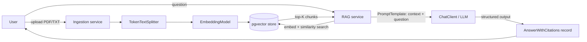

# Enterprise RAG Document Assistant

Axlero Java Development (Spring Boot) internship, **Project 2**. Upload company PDFs/text, turn them into vector embeddings, and chat with your documents. Answers come **only** from the uploaded content and include citations.

## How it works



## Tech stack

| Layer | Choice |
|---|---|
| Language | Java 21 (Records for DTOs) |
| Framework | Spring Boot 3.5.x |
| AI | Spring AI 1.1.x: `ChatClient`, `PromptTemplate`, `EmbeddingModel`, `TokenTextSplitter`, Structured Output |
| Vector DB | PostgreSQL + pgvector (Docker) |
| ORM | Spring Data JPA (Hibernate) |
| Security | Spring Security + JWT (stateless) |
| API docs | springdoc-openapi (Swagger UI) |
| Frontend | React (functional components, Axios/Fetch, streaming chat) |
| Build | Maven |

## Repo layout

```
backend/    Spring Boot app (layered: config, controllers, services, repositories, entities, dto, exceptions)
frontend/   React app
docker/     DB init scripts
docs/       Task briefs
scripts/    Repo/team bootstrap
```

## Run it locally

Prereqs: JDK 21, Maven 3.9+, Docker Desktop, Node 20+.

```bash
cp .env.example .env            # set OPENAI_API_KEY and JWT_SECRET in .env
openssl rand -base64 48         # copy the output into JWT_SECRET
docker compose up -d            # starts Postgres + pgvector
cd backend && mvn spring-boot:run
```

The app requires `JWT_SECRET` to contain a Base64-encoded cryptographically random secret of at least 32 bytes and will not start without it (generate one using `openssl rand -base64 48`). The application Base64-decodes this secret before using it as the signing key (HMAC-SHA256). Only `/api/auth/**`, `/v3/api-docs/**`, `/swagger-ui/**`, and `/actuator/health` are public. All other requests require a bearer JWT; the login endpoint will be added by the separate Security B task.

Smoke test the LLM connection: `GET http://localhost:8080/api/ai/ping`

Spring Boot reads `.env` automatically (see `application.yml`), so no manual exports needed. Never commit `.env`.

**Other LLM providers:** the OpenAI starter works with any OpenAI-compatible endpoint. Set `AI_BASE_URL`, `AI_CHAT_MODEL`, `AI_EMBEDDING_MODEL` in `.env` (for example a local Ollama), and make `EMBEDDING_DIMENSIONS` match the embedding model. If you change dimensions, drop the `vector_store` table so it is recreated.

## Team and ownership

| Role | Owner | Area |
|---|---|---|
| 1. Lead / DevOps | Anuj | CI, Docker, integration, README, demo |
| 2. Security | _TBD_ | JWT auth, SecurityConfig, CORS, Swagger config |
| 3. Ingestion (ETL) | Aniket | Upload API, extraction, chunking, embeddings, vector store writes |
| 4. RAG Engine | Yashu (team lead) | Retrieval, PromptTemplate, RAG service, streaming endpoint |
| 5. Data + Errors | Meghana | Entities, repositories, DTOs, structured output, global exception handler |
| 6. Frontend | Aryan | React login, upload, chat UI, streaming, citations |

## Rules

Read [CONTRIBUTING.md](CONTRIBUTING.md). Short version: **every member commits every working day**, Conventional Commits only, PRs merged with *Rebase and merge*, no secrets in git.

## Layered architecture

Controllers take/return DTO Records and contain no business logic. Services hold business rules and `@Transactional` boundaries. Repositories talk to the database. Entities never leave the service layer. Errors go through one `@RestControllerAdvice` returning RFC 7807 `ProblemDetail`.

## Local Environment Verification & Credentials

### Default Credentials
- **Admin**: `admin@example.com` / `password`
- **User**: `user@example.com` / `password`

### Prerequisites & Verification Notes
- **Docker**: PostgreSQL with `pgvector` extension running on port 5432.
- **Backend**: Spring Boot 3 running on port 8080 (Java 21).
- **Frontend**: Vite + React running on port 5173 (Node.js 20+ required).
- **PowerShell Note**: If script execution is restricted on Windows, run `Set-ExecutionPolicy -Scope CurrentUser RemoteSigned`.

## DevOps & Local Environment Setup

### Prerequisites
- Docker & Docker Compose
- Java 21 & Maven (for local backend development)
- Node.js 20 & npm (for local frontend development)

### Running Full-Stack via Docker Compose
To build and spin up PostgreSQL, Spring Boot backend, and React frontend simultaneously:

```bash
docker compose up -d
```

### Services & Port Mappings
- **Frontend Application:** `http://localhost:80`
- **Backend API:** `http://localhost:8080`
- **PostgreSQL Database:** `localhost:5432`

### Environment Configuration
Ensure your `.env` file contains the required configurations matching `.env.example`:
```env
DB_NAME=ragdb
DB_USER=rag
DB_PASSWORD=rag
SPRING_DATASOURCE_URL=jdbc:postgresql://postgres:5432/ragdb
```

### CI/CD Pipeline
- Automated build and test pipeline configured via GitHub Actions (`.github/workflows/ci.yml`).
- Triggers automatically on push and pull requests to `main`.