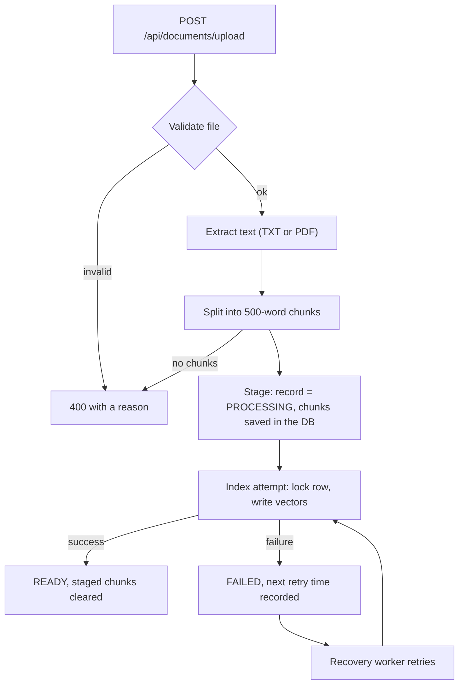

# Ingestion Pipeline

How an uploaded file becomes searchable chunks in the vector store, and what happens when something goes wrong.

Owner: Ingestion (ETL). Code lives in `backend/src/main/java/com/axlero/ragassistant/services/`.

## Flow

| Step | Class | What it does |
|---|---|---|
| Upload | `DocumentController` | Receives the multipart `file`, returns `201` with the document, or `400` for a validation error |
| Validate and extract | `DocumentService` | Checks the file and extracts its text |
| Chunk | `TextChunkingService` | Splits the text into chunks |
| Orchestrate | `DocumentIngestionService` | Extract, chunk, stage, then run the first index attempt |
| Stage | `DocumentChunkStagingService` | Saves the document record and its chunks in one transaction |
| Index | `DocumentRecoveryAttemptService` | Writes vectors, marks the document `READY`, handles failures |
| Retry | `DocumentIngestionRecoveryWorker` | Scheduled job that retries documents that are due |
| Delete | `DocumentDeletionService` | Removes vectors and the record |

## Validation rules

- The file must not be empty.
- Maximum size is 5 MB (checked in `DocumentService`). Spring's own multipart limit is 25 MB (`application.yml`), so a file between 5 and 25 MB reaches the service and is rejected there.
- Only TXT and PDF. The extension and the content type must both match: `.txt` with `text/plain`, or `.pdf` with `application/pdf`. Parameters such as `;charset=UTF-8` are ignored.
- A PDF must start with the `%PDF-` header. A PDF that cannot be read returns `400`, not `500`.
- If no text can be extracted (for example a scanned PDF), the upload is rejected with `400`.

## Chunking

- The text is split on whitespace and grouped into chunks of at most 500 words.
- There is no overlap between chunks, and line breaks and tabs are collapsed to single spaces.

## Why chunks are staged first

The database and the vector store cannot share one transaction, so a single "save everything" step could leave them inconsistent. Instead:

1. The document record (`PROCESSING`) and its chunks are saved in the database in one transaction (`document_ingestion_chunks`).
2. Indexing runs as a separate step that can be repeated safely.
3. The document becomes `READY` only after the vectors were written successfully.

If the server stops half way, the chunks are still in the database and the worker picks the document up again.

## Index attempt

`DocumentRecoveryAttemptService.process(documentId)` runs in a transaction:

1. Takes a row lock on the document (`findByIdForUpdate`). If the document no longer exists, or is already `READY`, it does nothing.
2. Deletes any vectors left by an earlier attempt, so vectors are never duplicated.
3. Writes one vector per chunk with the metadata `documentId`, `ownerId` and `filename`.
4. Marks the document `READY` and clears the staged chunks.

On failure it deletes partial vectors (a failing cleanup is attached to the original error, not lost), records the error and the next retry time, and returns the failure.

## Statuses and retries

| Status | Meaning |
|---|---|
| `PROCESSING` | Staged, waiting for or running an index attempt |
| `READY` | Vectors written, document is searchable |
| `FAILED` | The last attempt failed; a retry is scheduled unless the limit was reached |

- Retry delay doubles after each failure, starting at 30 seconds and capped at 1 hour.
- After 5 attempts no further retry is scheduled.
- If a document has no staged chunks, it is marked failed permanently.

## Recovery worker

- `DocumentIngestionRecoveryWorker` runs every 15 seconds (`app.document-ingestion.recovery-delay-ms`, default `15000`). Scheduling is enabled in `RagAssistantApplication` with `@EnableScheduling`.
- Each run handles up to 20 `PROCESSING` or `FAILED` documents whose retry time has passed, plus up to 20 `PROCESSING` documents with no retry time (left behind by a restart).
- A failure or an exception on one document does not stop the others.
- The row lock means two workers (or a worker and a delete) cannot process the same document at the same time.

## Deleting a document

`DocumentDeletionService` checks that the caller owns the document (admins can delete any), takes the same row lock, deletes the vectors by `documentId`, then deletes the record. The staged chunks are removed by `ON DELETE CASCADE`. If deleting the vectors fails, the record is kept and the client gets a "service unavailable" error.

## Owner scoping

Every vector carries the owner's id in its metadata, and `RetrievalService` always filters on it, so a user only searches their own documents.

## Troubleshooting

| Symptom | What to check |
|---|---|
| Upload returns "An unexpected error occurred" | Indexing failed, usually the embeddings call. Check `OPENAI_API_KEY` in `.env` (it must be a real key, not a placeholder) and the backend logs |
| Document stays `PROCESSING` | The worker retries every 15 seconds; check the backend logs for `Recovery attempt failed` |
| Document is `FAILED` | Read the error on the record, fix the cause (key, quota, network); it is retried until the limit |
| Changed the embedding model | Set `EMBEDDING_DIMENSIONS` to match it and drop the `vector_store` table so it is recreated, then upload again |

Backend logs: `docker compose logs backend --since 10m`

## Known limitations

- The database and the vector store are not atomic. Staging, retries and cleanup make the result consistent over time, not instantly.
- Retrieval filters on the owner only. It does not check the document status, so chunks of a document that is not yet `READY` could be returned.
- Scanned PDFs are not supported (no OCR).
- Chunks are split by word count with no overlap, so a chunk can end in the middle of a sentence.
- TXT files are always read as UTF-8.
- A file larger than 25 MB is rejected by Spring before reaching the controller, and there is no custom error response for it yet.
